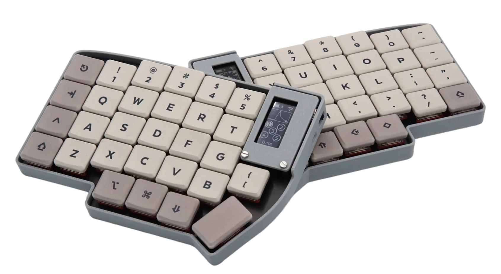

# Lily58 Wireless ZMK Config

Lily58 無線分體鍵盤的 [ZMK](https://zmk.dev/) 設定，左右兩側使用 nice!nano，並搭配 nice!view 顯示器。

<p align="center">
  
</p>

## 特色

- 7 個鍵盤層，Nav + Symbols 同時啟用時自動進入 Functions 層
- 拇指鍵使用 hold-tap（輕點與按住不同功能），並針對連打做誤觸防護
- 內建 tmux 快捷巨集與 Mouse、Gaming 層
- 左半邊啟用 [ZMK Studio](https://zmk.dev/docs/features/studio)，可即時調整 keymap
- 15 分鐘閒置自動睡眠，並調整藍牙參數以降低功耗

## 快速開始

在已安裝 ZMK 開發工具鏈的環境中，於 repo 根目錄執行：

```sh
west init -l config
west update
```

建置左右兩側（與 `build.yaml` 一致）：

```sh
west build -p=auto -d build/left -b nice_nano//zmk -S studio-rpc-usb-uart -- \
  -DSHIELD="lily58_left nice_view_adapter nice_view" \
  -DCONFIG_ZMK_STUDIO=y

west build -p=auto -d build/right -b nice_nano//zmk -- \
  -DSHIELD="lily58_right nice_view_adapter nice_view"
```

產物位於各自的 `build/` 目錄，`build.yaml` 流程中的 artifact 名稱為 `lily58-left`、`lily58-right`。此 repo 目前沒有 `.github/workflows/`，韌體不會自動建置。

> `config/west.yml` 追蹤 ZMK 的 `main` 分支，上游更新時可能影響建置；需要穩定版本時請改為固定 tag 或 commit。

## 按鍵配置

`config/lily58.keymap` 定義 7 個鍵盤層：

| 層 | 編號 | 用途 |
| --- | --- | --- |
| Base | 0 | 標準 QWERTY（預設層），含數字列、媒體播放與常用視窗快捷鍵 |
| Nav | 1 | 工作區切換（`Super+1~0`）、視窗移動（`Super+Shift+1~0`）、方向鍵、Home/End、翻頁、截圖、視窗切換、音量與曲目控制 |
| Symbols | 2 | 程式符號、括號與 tmux 快捷巨集 |
| Functions | 3 | F1–F12、`Alt+J/K`、`Super+W`，並提供 Mouse、System 層入口 |
| Mouse | 4 | 指標移動、捲動與左/右/中鍵點擊 |
| Gaming | 5 | 遊戲用配置（左手 WASD 區、數字鍵、Ctrl/Shift） |
| System | 6 | ZMK Studio 解鎖、藍牙配對、重啟與 bootloader |

### 層切換

| 來源 | 目標 | 方式 |
| --- | --- | --- |
| Base | Nav | 右拇指鍵按住（`&lh Nav BSPC`） |
| Base | Symbols | 左拇指鍵按住（`&mo Symbols`） |
| Nav + Symbols | Functions | 同時啟用時自動切換（`conditional_layers`） |
| Functions | Mouse / System | `&to Mouse`、`&to System` |
| Mouse | Gaming / Base | `&to Gaming`、`&to Base` |
| Gaming | System / Mouse / Base | `&to System`、`&to Mouse`、`&to Base` |
| System | Mouse / Gaming / Base | `&to Mouse`、`&to Gaming`、`&to Base` |

### 拇指鍵（Base 層）

左手由外到內、右手由內到外：

| 位置 | 左手 | 右手 |
| --- | --- | --- |
| 1 | `LMETA` | 按住 `Ctrl` / 輕點 `Enter`（`&em`） |
| 2 | 按住 `Alt` / 輕點 `Esc`（`&tm`） | 按住 `Nav` / 輕點 `Backspace`（`&lh`） |
| 3 | 按住切換 Symbols（`&mo`） | `RMETA` |
| 4 | 按住 `Shift` / 輕點 `Space`（`&tm`） | 無（`&none`） |

### 自訂行為

| 行為 | 類型 | 說明 |
| --- | --- | --- |
| `tm`（thumb_mods） | hold-tap | `tap-preferred`，tapping-term 150ms，quick-tap 150ms，`require-prior-idle-ms` 100ms；連打時一律視為輕點，避免誤觸修飾鍵 |
| `em`（enter_mods） | hold-tap | `balanced`，tapping-term 200ms，quick-tap 250ms，用於 Ctrl/Enter |
| `lh`（layer_hold） | hold-tap | `tap-preferred`，tapping-term 150ms，quick-tap 180ms，按住切層、輕點送出按鍵 |
| `tmx`（tmux_prefix） | macro | 先送出 tmux prefix `Ctrl+A`，再送出參數按鍵；用於 Symbols 層的 tmux 快捷（`W`、`C`、`\|`、`-`） |

### System 層

- `BT_CLR`：清除藍牙配對
- `BT_SEL 0` 至 `BT_SEL 4`：選擇配對槽
- `sys_reset`、`bootloader`：重啟與進入 bootloader（左右半邊各有一組）
- `&studio_unlock`：解鎖 ZMK Studio

## 韌體設定

`config/lily58.conf` 的主要設定：

| 項目 | 設定 |
| --- | --- |
| 裝置名稱 | `Lily58` |
| 藍牙連線間隔 | `CONFIG_BT_PERIPHERAL_PREF_MIN_INT=12`、`MAX_INT=24`（平衡延遲與功耗） |
| 背景掃描 | interval 512、window 36（降低耗電） |
| 睡眠 | 啟用 `CONFIG_ZMK_SLEEP`，閒置 900,000 毫秒（15 分鐘）後進入睡眠 |
| 按鍵去彈跳 | 按下 2ms、放開 5ms |
| 指標 | 啟用 `CONFIG_ZMK_POINTING`（Mouse 層使用） |

高功率發射（`CONFIG_BT_CTLR_TX_PWR_PLUS_8`）與 USB logging 相關選項目前為註解狀態，需要時再開啟。

### ZMK Studio

僅左半邊啟用：`build.yaml` 的左側目標使用 `studio-rpc-usb-uart` snippet 並設定 `-DCONFIG_ZMK_STUDIO=y`，因此 `lily58.conf` 中的 `CONFIG_ZMK_STUDIO` 保持註解。鎖定機制使用官方預設，需先按 System 層的 `&studio_unlock`。使用時請以 USB 連接左半邊。

## 更新鍵盤圖

`main.py` 需要 `keymap` CLI 可從 PATH 執行。在 repo 根目錄執行：

```sh
python3 main.py
```

腳本會解析 `config/lily58.keymap`，更新 `assets/lily58.svg`，並刪除中間產生的 YAML 檔案。

## 專案結構

| 路徑 | 說明 |
| --- | --- |
| `config/lily58.keymap` | layers、behaviors 與 tmux 巨集 |
| `config/lily58.conf` | ZMK Kconfig 設定 |
| `config/west.yml` | West manifest，追蹤 ZMK `main` |
| `build.yaml` | 左右兩側 nice!nano 建置目標（`nice_nano//zmk`），含 nice!view adapter 與顯示器 shield；左側額外啟用 ZMK Studio |
| `assets/` | 鍵盤照片與 keymap SVG |
| `main.py` | 使用 `keymap` CLI 從 keymap 產生 `assets/lily58.svg` |

## 授權

本專案採用 MIT License，詳見 [LICENSE.md](LICENSE.md)。
